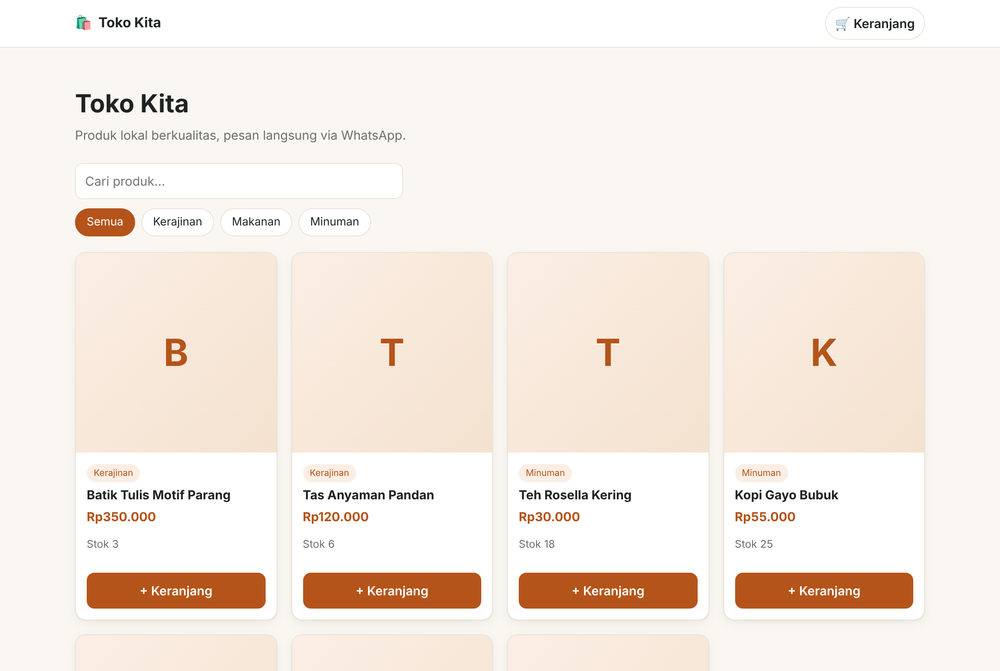
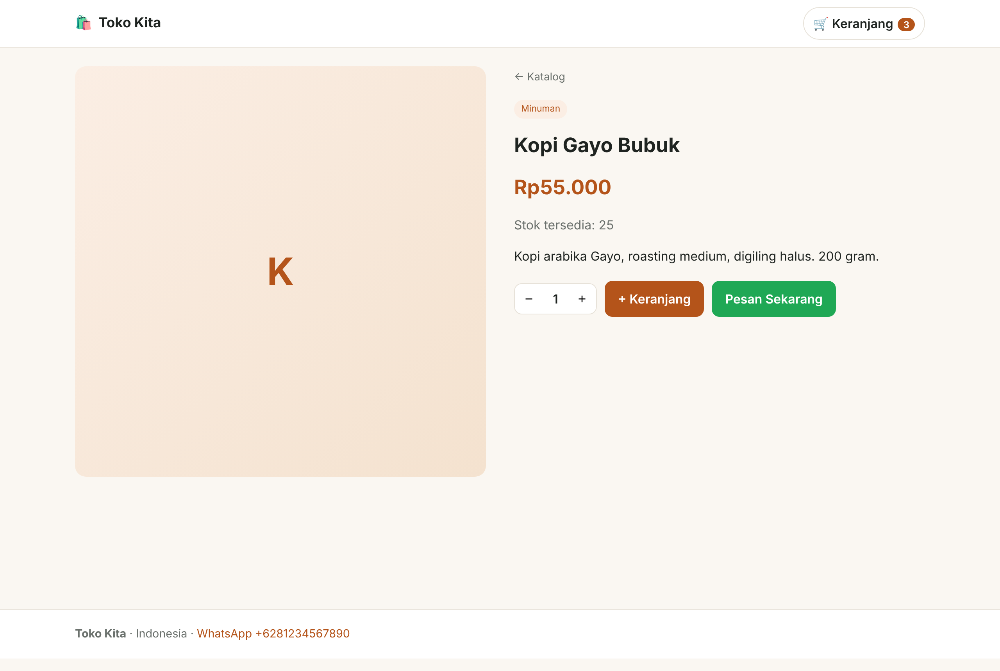
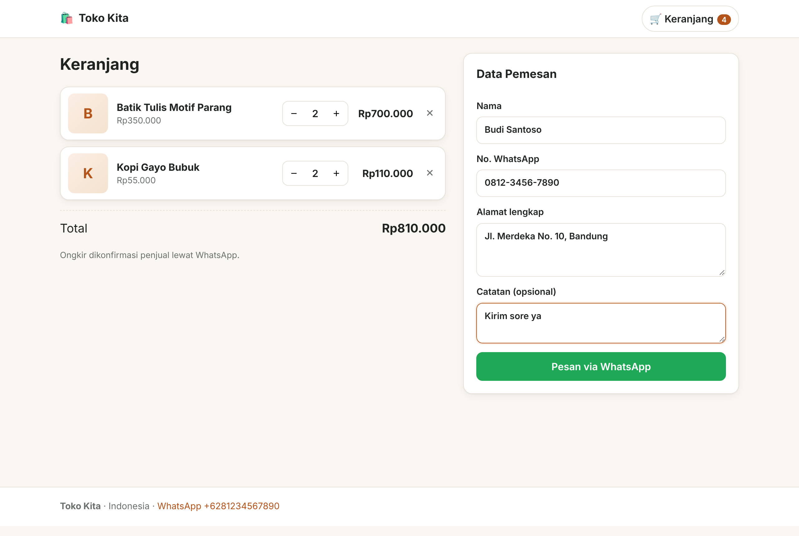
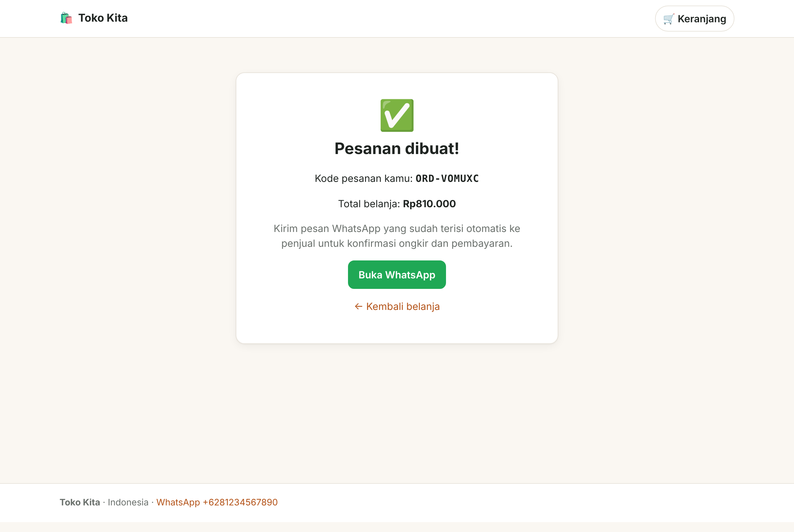
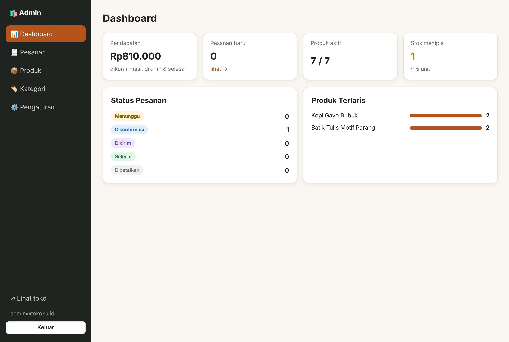
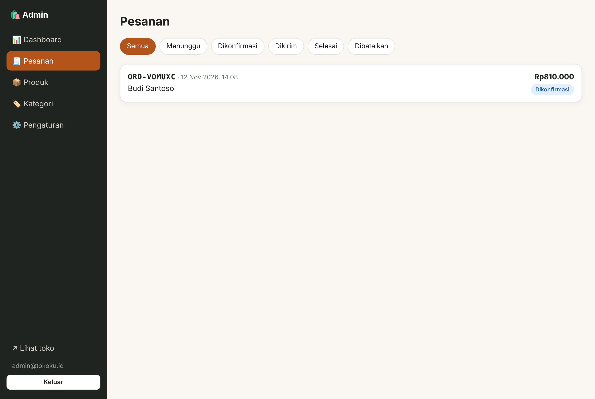
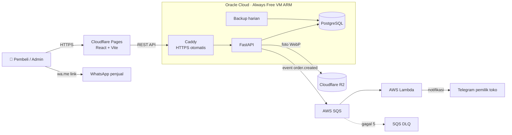

# 🛍️ Katalog UMKM + Order via WhatsApp

Website katalog produk untuk UMKM. Pembeli memilih produk, mengisi data, lalu **WhatsApp terbuka otomatis dengan pesan pesanan yang sudah terisi rapi**. Pemilik toko mendapat **notifikasi Telegram** setiap ada pesanan baru dan mengelola produk, stok, serta status pesanan lewat dashboard admin.

Dibangun **multi-cloud dengan biaya Rp0**: Oracle Cloud Always Free, AWS Always Free, dan Cloudflare free tier. Semua infrastruktur ditulis sebagai kode (Terraform), lalu dites dan di-deploy otomatis lewat GitHub Actions.


| Katalog | Detail produk |
|---|---|
|  |  |
| **Keranjang & checkout** | **Pesanan berhasil** |
|  |  |
| **Dashboard admin** | **Kelola pesanan** |
|  |  |

## ✨ Fitur

**Pembeli**
- Katalog dengan pencarian, filter kategori, dan pagination
- Keranjang belanja (tersimpan di browser)
- Checkout yang membuka WhatsApp penjual dengan pesan otomatis (kode pesanan, rincian, total, alamat)
- Tampilan responsif, nyaman dibuka di HP

**Admin**
- Login JWT
- Dashboard: pendapatan, pesanan baru, stok menipis, produk terlaris
- CRUD produk dan kategori; upload foto yang **otomatis di-resize dan dikonversi ke WebP**
- Kelola status pesanan (Menunggu → Dikonfirmasi → Dikirim → Selesai / Dibatalkan); **stok kembali otomatis** saat pesanan dibatalkan
- Pengaturan nama toko dan nomor WhatsApp

**Backend**
- Harga dan total **selalu dihitung ulang di server** (tidak percaya data dari browser)
- Row lock (`SELECT … FOR UPDATE`) agar stok tidak minus saat ada pesanan bersamaan
- Snapshot nama dan harga di item pesanan, jadi riwayat tidak berubah kalau harga produk diubah
- Notifikasi asinkron lewat antrian: kalau Telegram atau AWS bermasalah, pesanan tetap tersimpan

## 🏗️ Arsitektur



| Komponen | Layanan | Kenapa |
|---|---|---|
| Frontend | Cloudflare Pages | Gratis, CDN global, HTTPS otomatis |
| API + DB | Oracle Cloud VM A1 Flex (ARM) | Always Free sampai 4 OCPU / 24 GB RAM, tidak ada masa kedaluwarsa |
| Gambar | Cloudflare R2 | Gratis 10 GB, **tanpa biaya bandwidth**, kompatibel S3 |
| Antrian notifikasi | AWS SQS + DLQ | Always Free 1 juta request/bulan |
| Kirim notifikasi | AWS Lambda (arm64) | Always Free 1 juta request/bulan |
| Infrastruktur | Terraform | Semua resource bisa dibuat ulang dengan satu perintah |
| CI/CD | GitHub Actions | Test, lint, build, validasi Terraform, lalu deploy |

> Batas free tier bisa berubah sewaktu-waktu. Cek halaman resmi Oracle, AWS, dan Cloudflare sebelum deploy. Terraform AWS di repo ini sudah membuat **budget alert $1**.

## 🧰 Tech Stack

- **Backend:** Python 3.12, FastAPI, SQLAlchemy 2, PostgreSQL 16, Pillow, PyJWT, bcrypt, boto3
- **Frontend:** React 18, React Router, Vite (CSS murni, tanpa framework UI)
- **Infra:** Docker, Docker Compose, Caddy, Terraform (provider OCI dan AWS)
- **Testing:** pytest (API dan Lambda), ruff, build check di CI

## 📁 Struktur

```
backend/            FastAPI (app/), test (tests/), Dockerfile
frontend/           React + Vite (src/pages, src/pages/admin)
lambda/notify_order Lambda SQS → Telegram (tanpa dependensi)
infra/terraform/    oci/ (VM, VCN, firewall) · aws/ (SQS, Lambda, IAM, Budget)
deploy/             docker-compose.prod.yml, Caddyfile
.github/workflows/  ci.yml, deploy.yml
```

## 🚀 Menjalankan di Lokal

### Opsi A: Docker (paling mudah)

```bash
cp .env.example .env
docker compose up --build
docker compose exec api python -m app.seed   # data contoh
```

- Toko: http://localhost:5173
- Admin: http://localhost:5173/admin (login `admin@tokoku.id` / `admin12345`)
- Dokumentasi API (Swagger): http://localhost:8000/docs

### Opsi B: Tanpa Docker

```bash
# Backend (pakai SQLite otomatis)
cd backend
python -m venv .venv && source .venv/bin/activate
pip install -r requirements-dev.txt
python -m app.seed
uvicorn app.main:app --reload

# Frontend (terminal lain)
cd frontend
npm install
npm run dev
```

### Test

```bash
cd backend && pytest -q && ruff check .
cd lambda/notify_order && pytest -q
```

## ☁️ Deploy Gratis ke Cloud

<details>
<summary><b>1. Oracle Cloud: VM untuk API + database</b></summary>

1. Daftar di [cloud.oracle.com](https://cloud.oracle.com) (pilih home region yang dekat, misalnya Singapore).
2. Buat API key: *Profile → API keys → Add API key*, simpan file `.pem`, lalu catat OCID dan fingerprint.
3. Jalankan Terraform:
   ```bash
   cd infra/terraform/oci
   cp terraform.tfvars.example terraform.tfvars   # isi OCID dsb
   terraform init && terraform apply
   ```
   Kalau muncul *Out of host capacity*, ganti `ad_index` (0/1/2) atau coba lagi beberapa jam kemudian.
4. Arahkan DNS `api.domainkamu.com` (A record) ke `public_ip` dari output.
5. SSH ke VM lalu jalankan:
   ```bash
   git clone https://github.com/akhmadrizaldy74/akhmadrizaldy74-katalog-umkm.git katalog-umkm && cd katalog-umkm
   cp .env.example .env && nano .env   # isi JWT_SECRET, ADMIN_*, API_DOMAIN, POSTGRES_PASSWORD, CORS_ORIGINS
   docker compose -f deploy/docker-compose.prod.yml --env-file .env up -d --build
   ```
   Caddy otomatis membuat sertifikat HTTPS.
</details>

<details>
<summary><b>2. Cloudflare: frontend (Pages) + gambar (R2)</b></summary>

1. **R2:** buat bucket `katalog-umkm`, aktifkan *Public access* (r2.dev atau custom domain), lalu buat API token R2. Isi `R2_*` di `.env` server.
2. **Pages:** *Workers & Pages → Create → Pages → Connect to Git*, pilih repo ini.
   - Root directory: `frontend`
   - Build command: `npm run build`
   - Output: `dist`
   - Environment variable: `VITE_API_URL=https://api.domainkamu.com`
3. Masukkan domain Pages ke `CORS_ORIGINS` di `.env` server.
</details>

<details>
<summary><b>3. AWS: notifikasi Telegram (opsional)</b></summary>

1. Buat bot lewat [@BotFather](https://t.me/BotFather), lalu ambil chat id dari [@userinfobot](https://t.me/userinfobot).
2. Jalankan Terraform:
   ```bash
   cd infra/terraform/aws
   cp terraform.tfvars.example terraform.tfvars
   terraform init && terraform apply
   terraform output -raw api_secret_access_key
   ```
3. Isi `SQS_QUEUE_URL`, `AWS_ACCESS_KEY_ID`, `AWS_SECRET_ACCESS_KEY` di `.env` server, lalu restart: `docker compose -f deploy/docker-compose.prod.yml up -d`.

IAM user yang dibuat **hanya boleh `sqs:SendMessage`** ke satu antrian (least privilege).
</details>

<details>
<summary><b>4. GitHub Actions: deploy otomatis</b></summary>

Di *Settings → Secrets and variables → Actions*:

| Jenis | Nama | Isi |
|---|---|---|
| Variable | `DEPLOY_ENABLED` | `true` |
| Variable | `VITE_API_URL` | `https://api.domainkamu.com` |
| Variable | `CF_PAGES_PROJECT` | nama project Pages |
| Secret | `OCI_HOST` | IP VM Oracle |
| Secret | `OCI_SSH_KEY` | private key SSH |
| Secret | `CLOUDFLARE_API_TOKEN` | token dengan izin *Pages: Edit* |
| Secret | `CLOUDFLARE_ACCOUNT_ID` | account id Cloudflare |

Setiap push ke `main`: CI (test, lint, build, terraform validate) → deploy API ke Oracle → deploy frontend ke Cloudflare Pages.

Kalau frontend sudah terhubung langsung ke Cloudflare Pages lewat Git (langkah 2), job `web` boleh dihapus.
</details>

## 🔌 Ringkasan API

| Method | Endpoint | Akses |
|---|---|---|
| `GET` | `/api/products?q=&category=&page=` | publik |
| `GET` | `/api/products/{slug}` | publik |
| `GET` | `/api/categories` · `/api/store` | publik |
| `POST` | `/api/orders` → `{ order, whatsapp_url }` | publik |
| `POST` | `/api/auth/login` | publik |
| `POST/PUT/DELETE` | `/api/products`, `/api/categories` | admin |
| `POST` | `/api/products/{id}/image` | admin |
| `GET` | `/api/orders` · `PATCH /api/orders/{id}/status` | admin |
| `GET` | `/api/admin/stats` | admin |

Dokumentasi interaktif lengkap tersedia di `/docs`.

## 🗺️ Ide Pengembangan

- [ ] Migrasi database dengan Alembic
- [ ] Rate limiting endpoint order
- [ ] Varian produk (ukuran/warna)
- [ ] Multi-toko (SaaS untuk banyak UMKM)
- [ ] Monitoring Grafana + Prometheus di VM Oracle

## 📄 Lisensi

MIT
